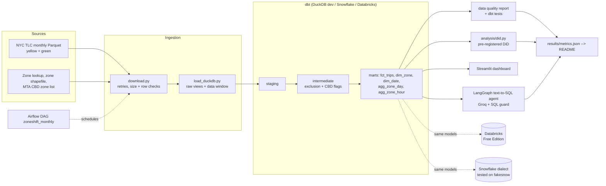
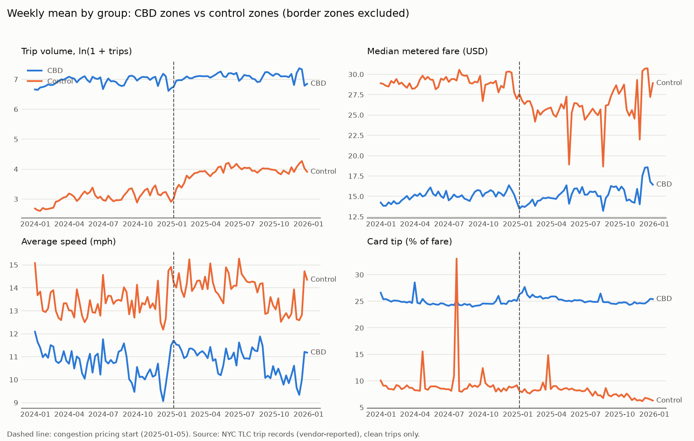
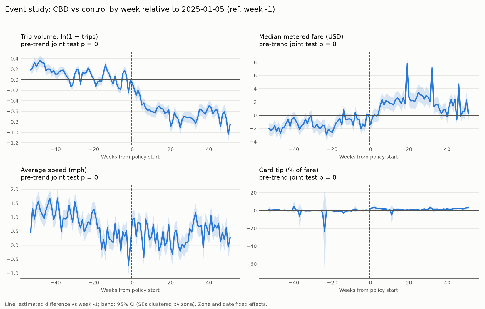

# ZoneShift

**How did NYC taxi pickups in Manhattan's Central Business District (CBD) change after congestion
pricing began on 2025-01-05, relative to comparable non-CBD zones?**

ZoneShift is an end-to-end analytics engineering and causal inference project on NYC TLC yellow
and green taxi trip records: ingestion with validation, a tested dbt warehouse on DuckDB, a
pre-registered difference-in-differences analysis, a Streamlit dashboard, a monthly Airflow DAG,
Snowflake-ready and Databricks deployments, and a text-to-SQL agent with a measured accuracy score.

> **Data note:** TLC trip records are submitted by technology vendors and are **not verified by
> TLC**. Every number in this README is produced by code and read from
> [`results/metrics.json`](results/metrics.json); none are typed by hand. The language is
> deliberately neutral: this project measures changes in taxi records and takes no position on
> the policy.

## Key numbers

<!-- KEYNUMBERS:START -->
_Generated by `analysis/render_readme.py` from `results/metrics.json`._

| | |
|---|---|
| Trips ingested (yellow + green) | 121,184,384 from 64 monthly files, 2024-01-01 to 2026-09-01 (exclusive) |
| Clean trips after quality rules | 112,670,220 (92.97% retained) |
| dbt tests (DuckDB) | 44 tests: 42 pass, 2 warn (by design), 0 fail |
| Treatment / border zones | 38 CBD zones (MTA list), 6 border zones (derived from zone polygons) |
| Pre-registered DiD | parallel trends rejected for 4 of 4 outcomes; estimates reported as descriptive contrasts (see Results) |
| Databricks (Free Edition) | dbt build 55 pass / 2 warn / 0 error on a 1/100 sample (1,211,877 trips); clean set identical to DuckDB: True |
| Text-to-SQL agent | 93.3% execution accuracy on 45 gold questions (openai/gpt-oss-120b); easy 93.3%, medium 100.0%, hard 83.3% |
<!-- KEYNUMBERS:END -->

## Architecture



More detail: [`docs/architecture.md`](docs/architecture.md).

## Method

- **Treatment definition:** the taxi zones on the MTA Congestion Relief Zone list (data.ny.gov),
  joined by zone ID, never hand-coded. **Border zones** (non-CBD Manhattan zones adjacent to the
  CBD) are derived from the zone polygons with spatial SQL.
- **Data quality:** seven exclusion rules (non-positive distance, negative fare, dropoff before
  pickup, over 3 hours, over 80 mph, outside the data window, unknown zone), each counted in
  [`docs/data_quality_report.md`](docs/data_quality_report.md).
- **Pre-registration:** [`analysis/PREREGISTRATION.md`](analysis/PREREGISTRATION.md) was committed
  before any model was run; `analysis/did.py` records its SHA-256 in `metrics.json`.
- **Model:** pickup zone x day panel, 2024-01-01 to 2025-12-31; two-way fixed effects (zone +
  date) with standard errors clustered by zone; weekly event study with a joint pre-trend test;
  four pre-registered robustness checks; Holm-adjusted p-values across the four outcomes.

## Results

<!-- RESULTS:START -->
_This block is generated by `analysis/render_readme.py` from `results/metrics.json`._

**Sample:** 38 CBD zones vs 165 control zones over 731 days; 54 rarely served non-CBD zones and 0 CBD zones dropped by the pre-registered activity rule.

### Main difference-in-differences (pre-registered)

| Outcome | Estimate | 95% CI | p | p (Holm) | Pre-trend test p | N zone-days |
|---|---:|---:|---:|---:|---:|---:|
| Trip volume, ln(1 + trips) | -0.714 (-51.0%) | [-0.785, -0.642] | <0.001 | <0.001 | <0.001 | 148,393 |
| Median metered fare (USD) | 3.159 | [2.563, 3.756] | <0.001 | <0.001 | <0.001 | 147,813 |
| Average speed (mph) | -0.392 | [-0.511, -0.272] | <0.001 | <0.001 | <0.001 | 147,813 |
| Card tip (% of fare) | 1.861 | [0.831, 2.892] | <0.001 | <0.001 | <0.001 | 144,457 |

### Robustness checks (pre-registered) and exploratory comparison

| Specification | Trip volume, ln(1 + trips) | Median metered fare (USD) | Average speed (mph) | Card tip (% of fare) |
|---|---:|---:|---:|---:|
| Placebo cutoff 2024-07-01 (2024 only) | -0.136 (p <0.001) | 0.241 (p 0.090) | -0.687 (p <0.001) | -1.270 (p 0.213) |
| Include border zones in control | -0.685 (p <0.001) | 3.047 (p <0.001) | -0.375 (p <0.001) | 1.795 (p <0.001) |
| Yellow taxis only | -0.781 (p <0.001) | 3.749 (p <0.001) | -0.350 (p <0.001) | 1.517 (p 0.018) |
| Drop holiday weeks | -0.715 (p <0.001) | 3.180 (p <0.001) | -0.436 (p <0.001) | 1.953 (p 0.003) |
| Exploratory: border zones vs control | -0.815 (p <0.001) | 3.201 (p <0.001) | -0.484 (p <0.001) | 1.816 (p <0.001) |

### What this does and does not show

- **The parallel-trends assumption is rejected** for 4 of 4 outcomes (joint test of event-study leads, p < 0.05). CBD and control zones were already diverging before 2025-01-05, so the DiD estimates above should not be read as causal effects of congestion pricing.
- **The placebo test fails** for trip volume and average speed: a fake cutoff on 2024-07-01 produces statistically significant "effects", which is further evidence of differential trends unrelated to the policy.
- Border zones (just north of 60th St, not charged) show a trip-volume estimate of -0.815 against the same control group, similar to the CBD estimate. The contrast looks more like Manhattan vs. the outer boroughs than a CBD-specific change.
- Descriptively (not pre-registered, pooled over trips rather than zones), average daily clean pickups changed by +9.5% in CBD zones, +4.8% in border zones, and +21.7% in all other zones (post vs pre). The pre-registered model weights every zone equally on a log scale, so proportional growth in low-volume outer-borough zones dominates its trip-volume estimate.

Figures: [trends](analysis/figures/trends_cbd_vs_control.png), [event study](analysis/figures/event_study.png). Full table: [`results/did_results.csv`](results/did_results.csv).
<!-- RESULTS:END -->




## Limitations

- **Parallel trends:** DiD needs CBD and control zones to follow the same trend absent the
  policy. The pre-trend and placebo diagnostics above test this directly; where they fail, the
  estimates are descriptive contrasts, not causal effects.
- **Spillover:** displaced trips can change control-zone outcomes. Border zones are excluded from
  the main control group, but spillover further away is not ruled out.
- **Concurrent changes:** other changes around January 2025 (fare or surcharge rules, seasonal
  patterns that differ between Manhattan and the outer boroughs, ride-hail competition, new
  taxi-dispatch vendors) are not separately identified.
- **Scope:** high-volume for-hire vehicles (Uber/Lyft) are not in the core data, so substitution
  between taxis and ride-hail is not observed. Outcomes are measured at the pickup zone, so trips
  that only end in or pass through the CBD are not captured as treated.
- **Vendor-reported data:** records are not verified by TLC; exclusion rules and their effect are
  documented in the data quality report.
- **Warehouses:** the Snowflake spatial SQL is written but not run on a live account (fakesnow has
  no GEOMETRY support, so the emulator target uses a precomputed fallback); Databricks runs on a
  deterministic 1% sample to stay within Free Edition quotas.
- **Agent:** accuracy is measured on hand-written questions over this one schema and does not
  generalize to other databases or question styles.

## Components

| Area | Where | Notes |
|---|---|---|
| Ingestion | [`ingestion/`](ingestion/) | Idempotent downloader (retries, size and row validation), DuckDB raw views, warehouse-neutral export |
| Warehouse | [`dbt/zoneshift/`](dbt/zoneshift/) | Staging, intermediate, marts; incremental `fct_trips`; generic + singular tests; source freshness; cross-database macros |
| Analysis | [`analysis/`](analysis/) | Pre-registration, DiD, event study, robustness, figures |
| Dashboard | [`dashboard/`](dashboard/) | Streamlit app (overview, trends, zone map, hour of day, causal results); BI build guide |
| Orchestration | [`orchestration/airflow/`](orchestration/airflow/README.md) | Airflow 3.3.2 in Docker, monthly DAG with backfill params; [run evidence](docs/airflow_run.md) |
| Snowflake | [`warehouse/snowflake/`](warehouse/snowflake/README.md) | Guardrails, DDL, stage + `COPY INTO`, key queries; tested on fakesnow (`tests/snowflake/`) |
| Databricks | [`warehouse/databricks/`](warehouse/databricks/README.md) | Live Free Edition deployment; [verification vs DuckDB](docs/databricks/verification.md) |
| Agent | [`agent/`](agent/README.md) | LangGraph text-to-SQL with SQL guard, repair loop, and execution-accuracy eval |
| CI | [`.github/workflows/ci.yml`](.github/workflows/ci.yml) | dbt build on a small real data slice + Snowflake-dialect tests |

## How to run

Requires Python 3.12 (the `setup` target uses [uv](https://docs.astral.sh/uv/) when available)
and about 2 GB of free disk for the core window.

```bash
make setup   # venv + pinned dependencies
make all     # ingest 2024-01..2025-12 (~1.5 GB) -> dbt build -> DQ report -> DiD -> dashboard data
make app     # Streamlit dashboard at http://localhost:8501
make test    # Snowflake-dialect tests on fakesnow
```

Optional:

```bash
make ask                                # text-to-SQL agent (GROQ_API_KEY in .env)
make agent-eval                         # re-score the agent on the gold questions
make databricks                         # Databricks Free Edition deployment (DATABRICKS_* in .env)
make airflow-build && make airflow-up   # Airflow in Docker; UI at http://localhost:8080
```

Copy `.env.example` to `.env` for the optional cloud and agent steps; `.env` is gitignored.
`make all` builds the core 2024-2025 window; the Airflow DAG extends the warehouse as TLC
publishes new months (the analysis stays pinned to its pre-registered window).

## Tech stack

Python 3.12 · DuckDB (+ spatial) · dbt Core (dbt-duckdb, dbt-snowflake, dbt-databricks) ·
pandas · linearmodels / statsmodels · matplotlib · Streamlit, Altair, pydeck · Apache Airflow 3
(Docker) · fakesnow · Databricks Free Edition · LangGraph · Groq · sqlglot · pytest · GitHub
Actions.
